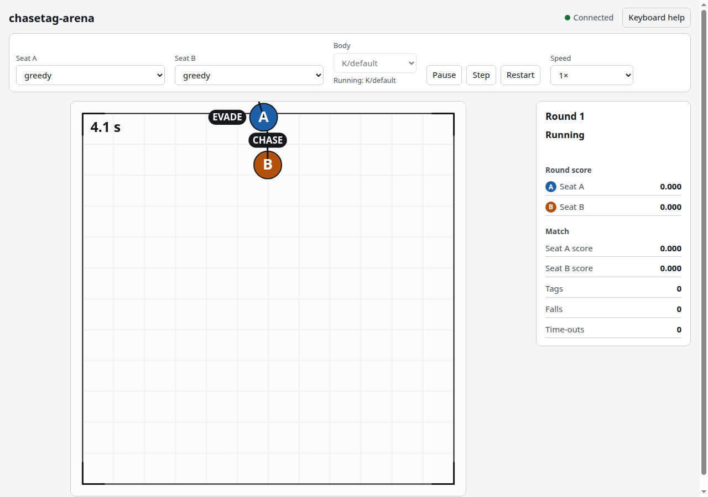

# chasetag-arena

[](https://github.com/kushagrathisside/chasetag-arena/actions/workflows/ci.yml)
[](LICENSE)

chasetag-arena is a one-on-one chase-tag game that runs in a web browser on your own computer. Two
bodies share a fenced 12 m × 12 m arena. One chases and the other runs, and the roles change each
round. Each seat is played by a person at the keyboard, a scripted bot, or a trained planner.



**Documentation:** <https://kushagrathisside.github.io/chasetag-arena/>

## Contents

- [Quick start](#quick-start)
- [Playing](#playing)
- [Command-line reference](#command-line-reference)
- [Rules and scoring](#rules-and-scoring)
- [Planners](#planners)
- [Research logging](#research-logging)
- [Development](#development)
- [Contributing](#contributing)
- [Licence](#licence)

## Quick start

You need Python 3.12 and [uv](https://docs.astral.sh/uv/). From a checkout of this repository:

```bash
uv sync
uv run chasetag-arena serve
```

The arcade opens at <http://127.0.0.1:8765/>. Press <kbd>Ctrl</kbd>+<kbd>C</kbd> in the terminal to
stop it. The [install guide](https://kushagrathisside.github.io/chasetag-arena/install/) explains each
step, and the [first round](https://kushagrathisside.github.io/chasetag-arena/getting-started/)
walks through a first game.

## Playing

The arcade has two seats, **A** and **B**. Choose who plays each seat from the menus above the arena.
A change applies at the start of the next round.

| Key | Action |
|---|---|
| <kbd>←</kbd> <kbd>↑</kbd> <kbd>↓</kbd> <kbd>→</kbd> | Drive the body in the keyboard seat. Set a seat to *keyboard* first. |
| <kbd>Space</kbd> | Pause, and press again to play. |
| <kbd>.</kbd> | Make one decision while paused. |
| <kbd>1</kbd> to <kbd>4</kbd> | Set the speed to 0.25×, 0.5×, 1× or 2×. |

The seats can be played by:

- **keyboard**: you, with the arrow keys;
- **planner**: a planner file loaded with `--planner`, or the fallback bot when none is loaded;
- **greedy**, **intercept**, **wander**, **idle** and **fallback**: scripted bots.

The round limit is set from the menu beside the speed control, or with `--time-limit`.

## Command-line reference

```text
chasetag-arena serve [options]     run the arcade on this machine
chasetag-arena enrol [options]     add a participant with research consent
```

Options for `serve`:

| Option | Default | Purpose |
|---|---|---|
| `--host ADDRESS` | `127.0.0.1` | Address to listen on. The default allows only this computer. |
| `--port N` | `8765` | Port to listen on. `0` picks a free port and prints it. |
| `--no-browser` | off | Print the address without opening a browser. |
| `--planner FILE` | none | Planner file for the planner seat. |
| `--time-limit SECONDS` | `60` | Longest round, in game seconds: `20`, `60`, `180`, `300` or `600`. |
| `--static-dir DIR` | built-in page | Folder of page files to serve instead of the built-in page. |
| `--store DIR`, `--migration FILE`, `--participant PSEUDONYM` | none | Log one session to a research store. See [Research logging](#research-logging). |

Run `chasetag-arena serve --help` for the full list. The
[API reference](https://kushagrathisside.github.io/chasetag-arena/api/) describes the HTTP routes that
the page uses.

## Rules and scoring

A round ends when one body tags the other, when a body falls, or when the round limit passes.

- **Tag:** the two pelvises come within 0.5 m. The chaser scores `1 − t/T` and the runner scores `t/T`,
  where `t` is the time of the tag and `T` is the round limit.
- **Fall:** a pelvis drops below 0.6 m. Neither seat scores.
- **Time-out:** the round limit passes with no tag and no fall. The runner scores 1 and the chaser scores 0.

The default round limit is one minute of game time. The 20-second round is the official rule set that
earlier results were recorded under, and it stays available. Game time, not wall-clock time, sets the
round length, so a round at 4× speed takes a quarter of the wall-clock time.

The full rules, with worked examples, are on the [rules page](https://kushagrathisside.github.io/chasetag-arena/the-game/).

## Planners

A planner is a trained policy saved as an `.npz` file in the layout that the exporter writes. Load one
with `--planner FILE`:

```bash
uv run chasetag-arena serve --planner path/to/planner.npz
```

The server checks each file before it plays. Its decision interval, speed limit, activation and layer
shapes must match the arena, and a file that fails a check is refused with a message that says why. The [planners page](https://kushagrathisside.github.io/chasetag-arena/planners/)
lists the checks and the file layout.

## Research logging

The arcade can write the rounds of a session to a research store, for a participant who has given
research consent. Nothing is logged by default.

```bash
uv run chasetag-arena enrol --store ~/chasetag-data --migration FILE --consent-text FILE
uv run chasetag-arena serve --store ~/chasetag-data --migration FILE --participant PSEUDONYM
```

> **Status:** experimental. The consent terms are a draft that has not been reviewed, and the page
> does not yet tell the player that a session is being logged. Use it for test runs only, with a
> stand-in participant. The [research logging page](https://kushagrathisside.github.io/chasetag-arena/research-logging/)
> describes what is written, how consent is recorded, and what is not built yet.

## Development

```bash
uv sync
uv run --no-sync python -m pytest
node --test tests/js/*.mjs
uv run --no-sync ruff check
uv run --no-sync ruff format --check
uv run --no-sync mkdocs build --strict
```

The Python package is in `src/chasetag_arena/`:

| Path | Contents |
|---|---|
| `core/` | The two-seat simulator. Copied from the research repository and checked by a hash test. See [`vendor/SYNC.md`](vendor/SYNC.md). |
| `agents/` | The scripted bots. Also copied, and checked the same way. |
| `arcade/` | The game loop, the HTTP server and the browser page. |
| `planner.py` | Loads and checks planner files. |
| `recording.py`, `ledger_writer.py`, `mock_player.py` | Research logging and its checks. |
| `cli.py` | The command-line interface. |

The [contributing guide](https://kushagrathisside.github.io/chasetag-arena/contributing/) covers the
layout in more detail, the diagrams, the screenshots and the release process.

## Contributing

Contributions are welcome. Read [CONTRIBUTING.md](CONTRIBUTING.md) first. Contributions are accepted
under the project licence and the [Contributor Licence Agreement](CLA.md), which is a draft under
review.

## Licence

Licensed under the [PolyForm Noncommercial License 1.0.0](LICENSE). You may use, change and share the
game for any noncommercial purpose. Commercial use needs a separate licence from the author. The
[licence page](https://kushagrathisside.github.io/chasetag-arena/license/) explains the terms in plain
language.
