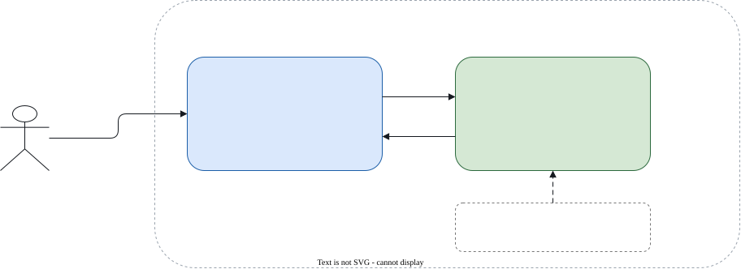
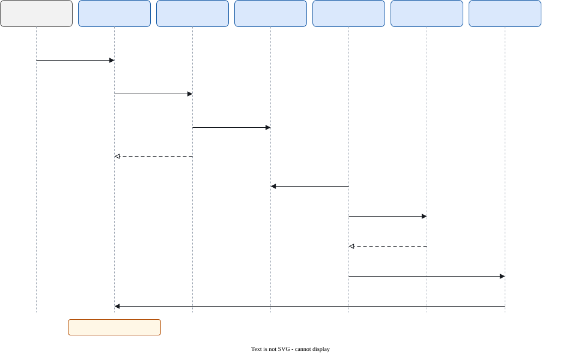

# Architecture

The game runs on one computer, in one Python process. A browser page shows it and sends commands
back. The rules of the game live only on the server.

## Parts

- **Browser client**: a static page with a canvas, the controls, the keyboard handling and an
  EventSource. It draws the arena and sends commands. It holds no game rules.
- **Local server**: the `chasetag-arena serve` command. It runs the HTTP handlers, the event stream
  and the control queue, and it starts the game thread.
- **Game loop**: the one thread that plays the game. It applies the controls, chooses both seats'
  actions, steps the simulator core, and publishes a frame.
- **Players**: the bots, the keyboard seat, and the planner seat, which plays the fallback bot until
  planner releases exist.
- **Vendored core**: the simulator core and the bots, copied from the groundtag research repository.

## Threads

One thread owns the game state: the game thread. The HTTP handler threads never read or write that
state. They call a small set of entry points on the game loop:

- `submit` takes a parsed control. Discrete controls (pause, play, step, restart and speed) go on a
  queue. The game thread drains the queue in arrival order before each decision. Selector changes go
  into a pending slot, which the game thread applies at the start of the next round. Keyboard commands
  are held per seat, with the time they arrived.
- `subscribe` and `unsubscribe` add and remove a viewer's frame queue.
- `latest_frame` returns the last frame without subscribing.

The shared values are either guarded by a lock or replaced as a whole tuple, so a reader never sees
one seat updated and the other not.

The game thread waits while no viewer is subscribed, or while the game is paused with no step pending.
An unwatched game therefore uses no CPU. A control, a new viewer or a stop request wakes the thread. When a deadline is missed, the game skips the missed decisions
rather than running them in a burst.

## Decisions and time

A decision is ten control steps of 0.01 s, so 0.1 s of game time. A round is 20 s of game time, which
is 200 decisions at most. The speed control changes how often a decision is made in wall-clock time.
It does not change the game.

Each decision does this:

1. Apply the queued controls, in order.
2. If the intermission is over, start the next round.
3. Choose the action for each seat from its selector.
4. Step the core.
5. Publish the frame, or the two frames that end a round.

## Frames

Every decision publishes one frame. A frame is a full snapshot of the arena: both bodies, the round
phase, the round score, the match totals and the selectors. Because each frame is complete, a viewer
that misses one loses nothing once the next arrives. The stream may drop the oldest frame from a slow
viewer's queue for the same reason.

Positions are rounded to the millimetre and headings to 0.0001 rad. A value that is not finite is
rejected, and the server never sends NaN or infinity. The fields are listed on the [API](api.md) page.

Each round goes through the phases in the diagram below. The selector changes apply only at the start
of a round.

## The vendored core

The simulator core and the bots module are copied from the groundtag research repository. Nothing in
them is written by hand. `scripts/sync_core.py` copies them and writes `vendor/SYNC.md`, which records
the groundtag commit and the SHA-256 hash of every copied file.

`tests/test_vendor.py` is the hash guard. It fails when a vendored file differs from its recorded hash,
when a file is added or removed, or when a vendored file imports a package this repository does not
have. A hand edit to the core therefore fails the test suite. The change belongs in groundtag, and it
arrives here through the sync script.

## The browser never runs game logic

The page does three things. It draws the frames it receives. It moves the drawn positions smoothly
between frames, by showing the arena 100 ms behind the newest frame. It sends the player's commands.
Tags, falls, scores, bot choices and the round timing are all decided on the server. A page that
is out of date or edited cannot change the rules of the game.
