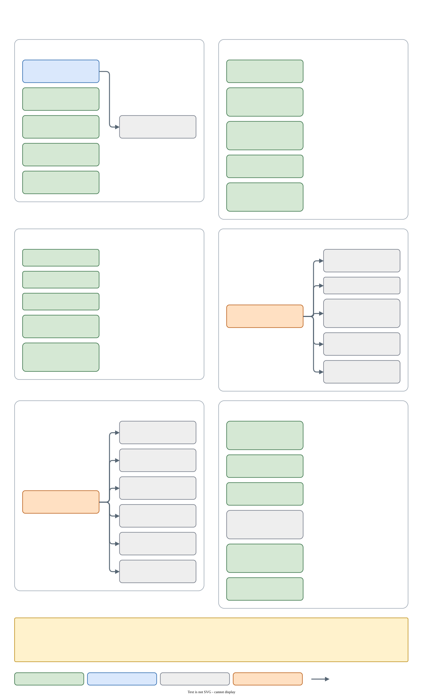

# Contributor dashboard

This page shows every contribution issue, and which of them you can take now. It reads the state of the issues from GitHub when you open it, so it is always up to date.

!!! info "How to use it"
    1. Look for issues marked **Ready**. Issues marked **Start here** unlock others, so they help the most.
    2. Open the issue, and comment to ask for it. Wait for the maintainer to assign it.
    3. An issue marked **Blocked** is waiting for another issue in the same epic. Please wait for it.
    4. There are no deadlines. Every epic stands on its own: nothing in one epic waits for another epic.

  
Loading the dashboard…

<noscript>
The dashboard needs JavaScript. The list of issues is on the <a href="https://github.com/kushagrathisside/chasetag-arena/issues?q=is%3Aissue+label%3Aopencode">issues page</a>.
</noscript>

## The plan at a glance

| Epic | Issues | Order |
|---|---|---|
| **1** Gameplay and Interface | 6 | 1.1 before 1.2 |
| **2** Accessibility | 5 | 2.1 before 2.5; 2.2 before 2.3 |
| **3** New Bodies | 5 | any order |
| **4** New Bots and Agents | 5 | 4.1 before 4.2, 4.3, 4.4, 4.5 |
| **5** Data and Analysis Tools | 7 | 5.1 before 5.2, 5.3, 5.4, 5.5, 5.6, 5.7 |
| **6** Documentation and Tutorials | 6 | any order |
| **7** Testing and Quality | open | open epic: propose your own sub-issues |

## Words used here

| Word | Meaning |
|---|---|
| **Ready** | Nothing has to be merged first, and nobody has been assigned. You may ask for it. |
| **Start here** | A ready issue that other issues in its epic are waiting for. |
| **Taken** | An issue that has been assigned to someone. |
| **Blocked** | An issue that waits for another issue in its epic to be merged. |
| **Done** | The issue is closed. |
| **Not published yet** | The issue is planned but has not been created on GitHub. |
| **Epic** | A group of related issues. Each epic stands on its own. |

## How the dashboard stays correct

The dashboard reads the issues labelled `opencode` from GitHub each time the page opens, and keeps the answer for five minutes. It works out *Blocked* from the issue states, so it needs no labels. A workflow also keeps the `status: ready` and `status: blocked` labels on GitHub in step with it. The plan itself (the issues, and what each needs first) is the file [`contribution-plan.json`](https://github.com/kushagrathisside/chasetag-arena/blob/main/docs/assets/contribution-plan.json).
