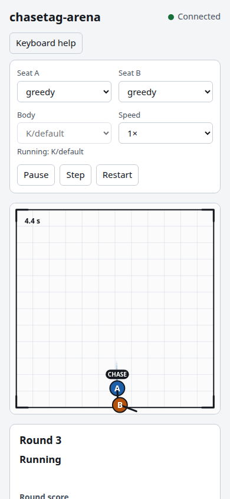

# Getting started

## Requirements

- Python 3.12. The project supports Python 3.12 only.
- The CPU build of JAX. The `jax` dependency installs it. No GPU is needed.
- [uv](https://docs.astral.sh/uv/), which installs the project and runs it.

## Install from source

In your own checkout of the repository, run this once, the first time:

```
uv sync
```

Run `uv sync` only in your own checkout, and only the first time. After that, `uv run` starts the
game.

## Start the game

```
uv run chasetag-arena serve
```

The command prints the address and opens it in your browser:

```
chasetag-arena: serving at http://127.0.0.1:8765/ (Ctrl+C to stop)
```

Press Ctrl+C in the terminal to stop the server.

### Options

| Option | Default | What it does |
|---|---|---|
| `--host ADDRESS` | `127.0.0.1` | The address to bind. The default is reachable from this computer only. |
| `--port N` | `8765` | The port to bind. `0` picks a free port and prints it. |
| `--no-browser` | off | Print the address without opening a browser. |
| `--static-dir DIR` | the copy in the package | A folder of page files to serve instead of the built-in page. |

## What the browser shows

The page has three parts:

- **Controls** across the top: a selector for each seat, the body, Pause or Play, Step, Restart,
  and the speed.
- **The arena**: a square fence with a grid. Body A is blue and body B is orange. The label on each
  body says whether it is chasing or running, and a short line shows its heading. The clock in the
  top-left corner shows the game time of the round.
- **The panel** on the right: the round number, the phase, the round score for each seat, and the
  match totals.

The connection status at the top right reads Connected, Reconnecting or Offline. If the server stops,
the page keeps trying to reconnect, and it shows the new server's game when the server is back. The
game makes no decisions while no page is open, so an unwatched game uses no CPU.

On a phone the panels stack under the controls and the arena, and the arena fills the width of the column:



Every control is explained on the [playing](playing.md) page.
