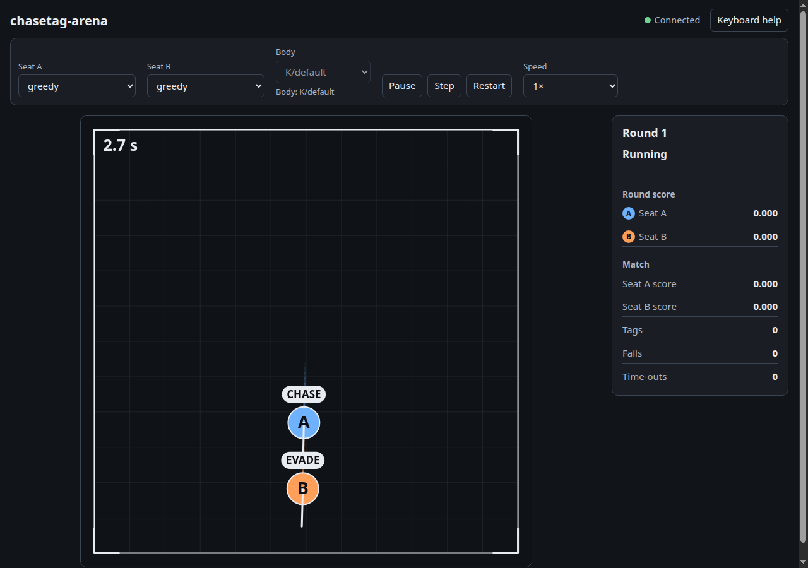

# First round

This page starts the server and walks you through a first round. It assumes you have finished the
[install](install.md).

## Start the server

From the `chasetag-arena` folder, run:

```bash
uv run chasetag-arena serve
```

The terminal prints the address and opens your browser:

```text
chasetag-arena: serving at http://127.0.0.1:8765/ (Ctrl+C to stop)
```

Leave this terminal open. The game runs in it, and Ctrl+C in this terminal stops the game.

!!! tip "The browser did not open?"
    Copy the address from the terminal, `http://127.0.0.1:8765/`, and paste it into your browser.
    See [troubleshooting](troubleshooting.md) for more.

## Play your first round

Work through these steps. Each step says what you should see.

1. **Choose seat A.** At the top of the page, open the **Seat A** list and pick `keyboard`. The
   body in seat A is the one you will drive. The label reads *Applies next round* until the round
   ends.
2. **Leave seat B as it is.** It is set to `greedy`, a bot that chases you hard when it is the chaser.
3. **Start.** The game starts running when the page loads. Use **Pause** if you want to stop it, and
   **Play** to start it again.
4. **Drive.** Press the arrow keys to move your body. Up moves it toward the top of the arena, and
   right moves it toward the right side.
5. **Watch the round end.** The round ends when one body tags the other, when a body falls, or when
   the round limit passes (60 s of game time by default). The round panel says which one happened.
6. **Read the score.** The round score shows what each seat earned in that round. The match totals
   below it add up every round since the game started or since you pressed **Restart**.
7. **Play the next round.** After a short pause of 1.5 s, the next round starts, and the roles swap.
   Changes to the seat lists apply now.



When you are done, press Ctrl+C in the terminal.

## Common first choices

| What you want | Set seat A to | Set seat B to | Notes |
|---|---|---|---|
| Play yourself against a bot | `keyboard` | `greedy` | The default bot is a sensible opponent. |
| Watch two bots | `greedy` | `wander` | Good for learning the rules without playing. |
| Practise a tag | `keyboard` | `idle` | `idle` never moves, so you can practise closing in on a still target. |
| Watch a planner | `planner` | `greedy` | Needs a planner file. See [planners](planners.md). |

## Options for `serve`

| Option | Default | What it does |
|---|---|---|
| `--host ADDRESS` | `127.0.0.1` | The address to listen on. The default lets only this computer connect. |
| `--port N` | `8765` | The port to listen on. `0` picks a free port and prints it. |
| `--no-browser` | off | Print the address without opening a browser. |
| `--planner FILE` | none | A planner file for the planner seat. Without it, the planner seat plays the fallback bot. |
| `--time-limit SECONDS` | `60` | The longest a round may run: 20, 60, 180, 300 or 600 game seconds. `20` is the official rule set that earlier results were recorded under. |
| `--store DIR` | none | The research store folder. Needed with `--participant`. See [research logging](research-logging.md). |
| `--migration FILE` | the `CHASETAG_LEDGER_MIGRATION` variable | The ledger migration file. Needed with `--store`. |
| `--participant PSEUDONYM` | none | Log this session for the participant with this pseudonym. Needs `--store`. |
| `--static-dir DIR` | the copy in the package | A folder of page files to serve in place of the built-in page. |

For example, to listen on port 9000 without opening a browser:

```bash
uv run chasetag-arena serve --port 9000 --no-browser
```

!!! warning "Keep the server on this computer"
    The server has no sign-in. Anyone who can reach it can control the game. Use the default
    `--host` unless you know your network and need another address.

## Next steps

- [The game](the-game.md) explains the arena, the rules and the scoring in full.
- [Playing](playing.md) describes every control on the page.
