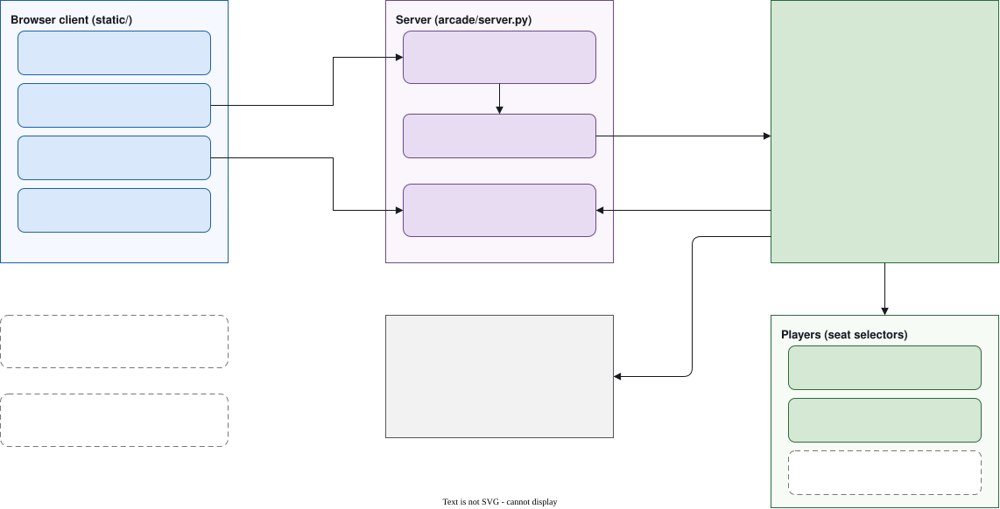

# How it works

The game runs as one Python program on your computer. A browser page shows the game and sends your
commands back. The rules are decided only by the program, so the page can show the game but cannot
change how it plays.

## The parts

| Part | Job |
|---|---|
| **Browser page** | Draws the arena and the scores, shows the controls, and reads the keyboard. It moves the drawn bodies smoothly between frames. |
| **Local server** | Serves the page, sends the frames as a live stream, and receives your controls. |
| **Game loop** | The one thread that plays the game. It applies the controls, chooses each seat's move, steps the game, and publishes a frame. |
| **Players** | The bots, the keyboard seat and the planner seat. Each one chooses a seat's move. |
| **Simulator core** | The physics, the body model, the tag and fall rules, and the scoring. |

## One decision, from key press to picture

Each decision moves the game forward by 0.1 s of game time. Here is how a key press reaches the
screen.

## What runs each decision

The game loop makes one decision each time its clock says so. A decision does five things, in this
order:

1. Apply the queued controls, such as Pause, Speed or Restart, in the order they arrived.
2. If the intermission is over, start the next round, and apply any seat changes.
3. Choose the move for each seat from its choice: the keyboard, a bot, or the planner.
4. Step the simulator core by 0.1 s of game time.
5. Publish a frame, or two frames if the round has just ended.

## Timing

| What | Value |
|---|---|
| One decision | 0.1 s of game time. At 1× speed, that is 10 decisions a second. |
| One round | At most 600 decisions, which is the round limit: 60 s of game time by default. |
| Intermission | 1.5 s of wall-clock time. |
| Keyboard command, sent by the page | Re-sent every 0.1 s while a key is held. |
| Keyboard command, held by the server | Expires 0.25 s after the last message, so a lost key release cannot keep a body moving. |
| Drawing delay | The page draws the arena 100 ms behind the newest frame, so the motion is smooth. |
| Quiet stream | A comment is sent every 15 s, so the connection stays open. |
| Speed | Changes how often decisions come in wall-clock time. It does not change the rules. |

## Frames

Every decision produces one frame. A frame is a complete picture of the arena: both bodies, the round
phase, the scores, the match totals, the seat choices, whether the game is paused, and the speed.

Because every frame is complete, a page that misses one loses nothing once the next one arrives. A
slow page may skip frames, but it never slows the game down.

Values are rounded for the display: positions to the millimetre, headings to four decimals, and
scores to three decimal places. The server never sends a value that is not a finite number. The
fields are listed on the [API](api.md) page.

## Why the page cannot change the rules

The page does three things: it draws the frames it receives, it moves the drawn bodies smoothly, and
it sends your commands. Everything that decides the game happens on the server: the tags, the falls,
the scores, the bots' choices, and the timing of each round.

So a page that is out of date, or edited by hand, can show the game badly, but it cannot make a
tag count or change a score.

## The page and the game share state through the server

The page and the server keep their own copies of what they show, and they agree through the frames.

- **Pause and speed.** Every frame carries the current pause and speed. A pause sent from one page
  appears in every other page at once, and a page that reconnects shows the true state.
- **Seat choices.** A change waits until the next round starts. The page shows *Applies next round*
  until the server's frame confirms it.
- **Your commands.** The server accepts a command and queues it. The game applies it at its next
  decision, and the change appears in the next frame.

## Resource use

An unwatched game uses no CPU. When no page is open, or the game is paused with no step waiting,
the game loop sleeps until something wakes it: a page connecting, a command, or a stop request.
Only the time the game is actually watched costs any processing.

## The game loop's threads

The server has two groups of threads.

- **The game thread** owns the game state. Only it reads or changes the state.
- **The request threads** handle the page, the stream and the commands. They do not touch the game
  state. They hand their work to the game thread through a queue, or through a small shared value
  that the game thread reads at its next decision.

This split means the game keeps a steady pace even when a browser is slow, and no two threads ever
edit the same state at once.
