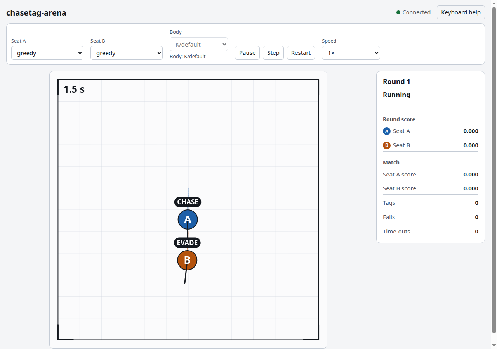

# chasetag-arena

chasetag-arena is a game of one-on-one chase tag that runs on your own computer, and its source code is public. Two bodies share a fenced
12 m × 12 m arena. One body chases the other, and the roles swap every round. A tag, a fall or
the end of the clock finishes the round, and every round gives each player a score between 0 and 1.

The game runs on your own computer. You start a small local server, and the game opens in your
browser, where you watch the rounds live and drive either body with your keyboard.



## At a glance

| Item | Detail |
|---|---|
| **Players** | Two seats. Each seat is played by you (keyboard), a scripted bot, or a trained planner. |
| **Arena** | A 12 m × 12 m square with a fence. Bodies cannot leave it. |
| **Round** | Up to 20 s of game time. It ends on a tag, a fall, or the clock. |
| **Scoring** | Each round gives the chaser and the runner a score from 0 to 1. The match adds them up. |
| **Runs on** | Your own computer, in a browser. No account, and no internet connection needed to play once installed. |
| **Needs** | Python 3.12, the [uv](https://docs.astral.sh/uv/) tool, and a modern browser. |

## Start in three commands

From a checkout of the repository:

```bash
uv sync
uv run chasetag-arena serve
```

The game opens at `http://127.0.0.1:8765/`. Stop it with Ctrl+C in the terminal. The
[install guide](install.md) explains each step, and the [first round](getting-started.md)
walks you through your first game.

## How the pieces fit

The game has three parts: the browser page you see, a local server that runs the rules, and the
players that choose each body's moves.


## What you can do

- **Watch two bots play**, for example greedy against wander, to see how the rules work.
- **Play yourself** with the arrow keys against any bot.
- **Load a planner** with `--planner FILE` and watch it play one seat.
- **Pause, step, restart and change the speed** to study a round closely.
- **Read the scores** for the round and for the whole match.

## Status

| Part | Status |
|---|---|
| Local server, browser page, game loop | Ready |
| Keyboard, bot and planner seats | Ready |
| Scores, match totals, pause, step, restart, speed | Ready |
| Planner files from releases, with checksums | Planned |
| Saving rounds, comparing planners, sharing logs | Planned |
| Desktop installer | Planned |

The [roadmap](roadmap.md) lists every planned item.

## Guide

| Page | What it covers |
|---|---|
| [Install](install.md) | What you need and how to install the game. |
| [First round](getting-started.md) | Start the server and play your first round. |
| [The game](the-game.md) | The arena, the roles, the rules, and how each round is scored. |
| [Playing](playing.md) | The screen, the seats, the controls and the keyboard. |
| [Planners](planners.md) | What a planner is and how to load one. |
| [Troubleshooting](troubleshooting.md) | Common problems and how to fix them. |
| [How it works](how-it-works.md) | The architecture, the timing, and why the browser never decides the rules. |
| [API](api.md) | The HTTP endpoints, the frame format and the control messages. |
| [Contributing](contributing.md) | Tests, lint, diagrams, screenshots and the docs build. |
| [Roadmap](roadmap.md) | What is ready and what is planned. |
| [License](license.md) | What you may do with the game. |
