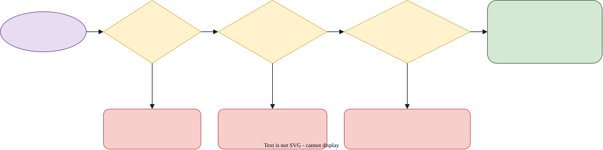

# Planners

A **planner** is a player that has learned how to play. It is a neural network stored in one file.
Once a second planner is loaded, the **planner** choice in a seat's list plays that body.

Planners are the way to see what a learned player does in the arena. Each planner file was made by
training, and training happens outside the game. The game only loads and runs a finished file.

## What a planner sees and does

| Part | Detail |
|---|---|
| **Sees** | 17 numbers: its role (chaser or runner), the other body's position and velocity relative to its own heading, the distance between the bodies, both positions within the arena, its heading, its own velocity, its pelvis height, and how much of the round is left. |
| **Does** | Chooses one planar velocity command every decision, which is every 0.1 s of game time. |
| **Plays** | The average of its policy, not a random draw. The same position always gets the same move. |
| **Body** | The default body, `K/default`. |

## Load a planner

Start the server with the file:

```bash
uv run chasetag-arena serve --planner path/to/planner.npz
```

When the file loads, the page enables the **planner** choice, and the list shows its name:

```text
planner (planner_2d_run3)
```

Set a seat to that choice, and it applies at the next round. Put the planner against a bot to watch
it play, or against your keyboard seat to test it.

You can check the loaded planner at any time. The server answers at `GET /planner`:

```bash
curl http://127.0.0.1:8765/planner
```

```json
{"loaded": true, "name": "planner_2d_run3", "file": "planner_2d_run3.npz"}
```

## What the server checks

The server reads the file before it starts. It checks that the planner can run in this arena, and it
refuses a file that cannot.



| Check | Refused when |
|---|---|
| The file can be read | The path does not exist, or the file is damaged. |
| It is a planner file | It has no description record, or the record is not a JSON object. |
| The body matches | The file is for a different body model. |
| The timing matches | It decides at a different interval from the arena's 10 control steps. |
| The speed limit matches | Its speed limit is not the arena's 1.5 m/s. |
| The activation is known | Its activation function is not one of `elu`, `tanh` or `relu`. |
| The shapes match | Its weight or bias arrays do not fit two outputs and 17 inputs. |
| The numbers are finite | Any value is NaN or infinity. |

When a file is refused, the server prints the reason and stops, with a message like this:

```text
chasetag-arena: planner.npz decides every 5 control steps; the arena decides every 10
```

Fix the file or choose another one, then start the server again.

## When no planner is loaded

Without `--planner`, the **planner** choice is greyed out in the list, and it reads
`planner (not loaded)`. A seat that asks for a planner anyway plays the **fallback** bot instead.

## The file

A planner file is a single `.npz` archive. It holds:

- the network's weights and biases, one pair per layer;
- the observation normaliser, which holds the mean and the variance of the 17 inputs;
- a small description record in JSON, which names the activation and the number of layers, and
  optionally a display name.

You do not need to edit the file. The server reads it, and nothing is written back.

## Where planner files come from

The game does not yet download planner files. Releases with checksums are on the
[roadmap](roadmap.md). Until then, you load a file that you already have, by its path.

## Troubleshooting

See [troubleshooting](troubleshooting.md#planners) for the messages you may see.
