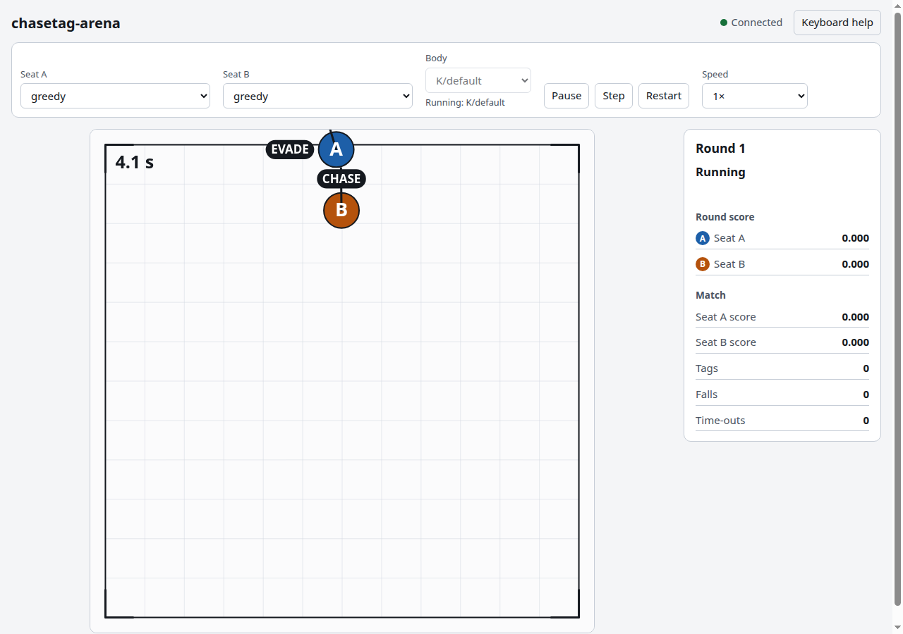

# Playing

The page controls the game on the server. Each control below sends one request to the server, and
the game applies it on its own thread.

## Seats

Each seat is one body in the arena. Seat A is blue and seat B is orange. The selector for a seat
chooses who plays it.

| Choice | Who plays the seat |
|---|---|
| `keyboard` | You, with the arrow keys. |
| `greedy` | A bot. When chasing, it heads straight at the other body. When running, it heads straight away and keeps off the fence. |
| `intercept` | A bot. When chasing, it aims where the other body will be. When running, it behaves as greedy does. |
| `wander` | A bot. It drifts in a random direction. |
| `idle` | A bot. It never moves. |
| `fallback` | A bot. It is the cautious stand-in for a trained planner: it caps its speed, and it keeps falls rare. |
| `planner` | The planner file given with `--planner FILE`. Without one, the choice is disabled on the page. |

A change of selector shows "Applies next round" until the next round starts. A selector never
changes a round in progress. Which seat chases is drawn at random for each round.

The Body selector shows `K/default`. It is the only body today, so the selector is disabled.

## Playback

- **Pause** stops the game from making decisions. The button then reads **Play**, and the round panel
  shows "Paused". **Play** resumes.
- **Step** makes exactly one decision. If the game is running, Step pauses it first.
- **Restart** starts a new round and clears the match totals.
- **Speed** sets how fast decisions come in wall-clock time: 0.25×, 0.5×, 1× (the default), 2× or
  4×. Speed does not change the game itself.

## Keyboard

| Key | Action |
|---|---|
| Arrow keys | Drive the keyboard seat. Up is toward the top of the arena, and right is toward its right side. |
| Space | Pause, or play again if paused. |
| Period (`.`) | Step one decision. |
| `1`, `2`, `3`, `4` | Set the speed to 0.25×, 0.5×, 1× and 2×. |

Speed 4× is not on the number keys. Choose it from the Speed list.

The keyboard seat is the seat whose selector is `keyboard`. If both seats are set to keyboard, seat A
is the one the arrow keys drive. Set a seat to `keyboard` before you press the arrows.

The arrow keys set a velocity of up to 1.5 m/s. Two arrows pressed together move the body diagonally at
the same speed. Opposite keys cancel out. The body stops when you release the keys, and it also stops
if the window loses focus.

## Scoreboard

- **Round score**: the score of each seat for the round that has just ended. It reads 0.000 while a
  round is running, and it keeps the last round's values during the intermission.
- **Match**: the score of each seat, added up over the rounds since the last Restart. It also counts
  the tags, the falls and the time-outs.

## Round phases

A round goes through these phases, in this order:

1. **Running**: the bodies move, and the panel reads "Running" (or "Paused").
2. **Round over**: the round ends in one of three ways, and the panel says which. "Round over: tagged"
   means one body tagged the other. "Round over: fell" means a body fell. "Round over: time out"
   means the 20 s of game time ran out. On a tag or a fall, the arena flashes once at the point of
   the event.
3. **Intermission**: the panel shows "Next round in" with a countdown of 1.5 s. The round score stays
   on screen.
4. The next round starts. Any selector changes take effect now, and the bodies return to their
   starting positions.

