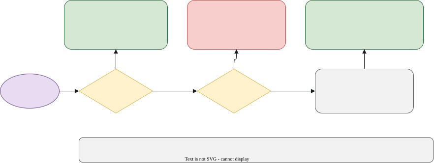

# The game

chasetag-arena is a game for two players. One body chases, and the other runs. The chaser wins by
tagging the runner, and the runner wins by staying free for as long as it can. The roles swap from
round to round, so each seat plays both parts.

## The arena

| Feature | Value |
|---|---|
| Shape | A square with a fence on each side |
| Size | 12 m × 12 m. The fence lines run from -6 m to 6 m on both axes. |
| Bodies | Two. Seat A is blue, and seat B is orange. |
| Starting gap | The bodies start 2 m apart. |
| Who chases | Chosen at random for each round. |
| Speed limit | 1.5 m/s for each body. |

The fence is a wall. A body cannot leave the arena.

## Roles

- **The chaser** tries to tag the runner as early as possible.
- **The runner** tries to avoid the tag, and to keep its own body upright.

The chaser's score falls the later the tag happens, and the runner's score rises. The next section
shows the numbers.

## How a round ends

A round ends in exactly one of three ways.

| Event | When it happens | What it means |
|---|---|---|
| **Tag** | The two bodies come within 0.5 m of each other, measured from the pelvis. | The chaser has caught the runner. |
| **Fall** | A body's pelvis drops below 0.6 m. A standing body's pelvis is about 0.95 m high. | The body has fallen, and nobody scores. |
| **Time-out** | The round limit passes with no tag and no fall. The limit is 60 s of game time by default, or 180, 300 or 600 s when chosen. | The runner has survived. |

The round clock counts game time, not wall-clock time. At the normal speed, a round takes about as
long as its game time, which is at most the round limit. A round set to 4× speed takes about a quarter
of that in wall-clock time, but its game time is the same.

## Scoring

Each round gives each seat a score between 0 and 1. The score depends on how the round ended.

| Ending | Chaser's score | Runner's score | Total |
|---|---|---|---|
| Tag at time *t* | 1 − *t*/*T* | *t*/*T* | 1 |
| Fall | 0 | 0 | 0 |
| Time-out | 0 | 1 | 1 |

Here *t* is the game time of the tag, in seconds, and *T* is the round limit: 60 s by default.

### Worked examples

| Round | Result | Chaser | Runner |
|---|---|---|---|
| A | Tagged at 5 s | 0.92 | 0.08 |
| B | Tagged at 15 s | 0.25 | 0.75 |
| C | Survived the round limit | 0.00 | 1.00 |
| D | Fell at 8 s | 0.00 | 0.00 |

Two things follow from these numbers:

- On a tag or a time-out, the two scores add up to 1. A fall is the only case where neither seat
  scores.
- A chaser that tags early scores more. A runner that is tagged late scores more, and a runner that
  survives the full round limit scores 1, the most a runner can get.

### The match

The **match** totals add up every round since the last **Restart**. The panel also counts the
tags, the falls and the time-outs. The totals are shown to three decimal places.

## Bodies and speeds

Each body moves by a planar command: a velocity in metres per second. The body can move in any
direction, but never faster than 1.5 m/s. A keyboard seat sends the same kind of command, so a
diagonal key press keeps the same top speed of 1.5 m/s rather than 1.5 m/s on each axis.

The decisions come in steps of 0.1 s of game time. Each step, every seat's chosen command takes
effect. The round therefore has at most 200 decisions.

## Strategy in brief

| If you are | Aim for |
|---|---|
| The chaser | Close the gap quickly and tag early. A tag at 2 s scores 0.90, and a tag at 18 s scores 0.10. |
| The runner | Keep the gap open, and keep your body upright. A survived round scores 1.00, and a fall scores nothing. |

A fall ends the round for both seats, so a body that drops below 0.6 m costs its seat the round.

## Matches and rounds

- A **round** is one chase, from the first frame to the end of the clock or the tag.
- A **match** is every round since the last **Restart**, or since the server started.
- Between rounds there is a pause of 1.5 s of wall-clock time, while the score stays on screen.

Next, see [playing](playing.md) for the controls, or [planners](planners.md) for trained players.
